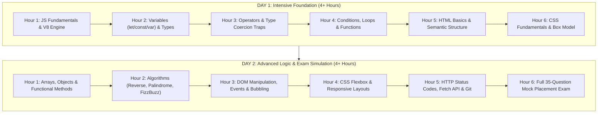

# ⚡ PrepForge — Itransition Front-end Test Prep

[](https://react.dev/)
[](https://www.typescriptlang.org/)
[](https://vitejs.dev/)
[](https://tailwindcss.com/)
[](https://opensource.org/licenses/MIT)

> **An intensive, practical, and interactive learning portal engineered specifically for candidates preparing for the Itransition Front-end Specialization Training Program placement test in Bangladesh within a strict 48-hour deadline.**

---

## 📌 Context & Motivation

Preparing for a competitive technical placement test with limited time demands an active, high-yield preparation strategy rather than passive reading. 

- **Target Placement**: Itransition Front-end Specialization Training Program (Bangladesh)
- **Candidate Skill Profile**: HTML (Beginner), CSS (No Experience), JavaScript (No Experience), Programming Logic (Intermediate)
- **Preparation Horizon**: 48 Hours (2 Days)
- **Daily Target**: 4+ hours of active, hands-on study
- **Benchmark Goal**: Score 70%+ on technical screening covering JavaScript mechanics, DOM & browser events, HTML semantics, CSS box model & flexbox, and output prediction.

---

## 🚀 Key Features

### 1. 📊 Executive Dashboard & Time Tracking
- **Live 48-Hour Deadline Clock**: Real-time Hours:Minutes:Seconds countdown with alert styling when entering the final 12 hours.
- **Active Study Session Stopwatch**: Live timer tracking cumulative active study time.
- **Daily Progress Bar**: Visual indicator showing completion against the daily 4-hour commitment.
- **Dynamic Weakest Topics Radar**: Aggregates missed questions across quizzes and mock exams to highlight topics that need immediate review.
- **Smart "Continue Learning"**: One-click action leading directly to your next uncompleted or highest-priority lesson.
- **Streak & Milestone Tracker**: Tracks Day 1 and Day 2 preparation milestones.

### 2. 📚 Complete 5-Module Curriculum
Each lesson is designed with:
1. **Simplified Explanations**: Core theory broken down for beginners without academic fluff.
2. **Key Takeaway Badges**: Fast-recall cheat points for examination day.
3. **Practical Code Examples**: Snippets with full line explanations and expected outputs.
4. **Common Interview Traps**: What candidates get wrong, why engines behave that way, and how to fix them.
5. **Instant Knowledge Checks**: Interactive flash quizzes with immediate answers and rationale.
6. **Sandboxed Code Runner**: Write and run JavaScript directly in the browser; inspect logs and run automated test assertions.
7. **Topic Assessment**: Scored end-of-lesson quizzes that automatically route incorrect answers to the Mistake Vault.

#### Curriculum Modules Breakdown:
| Module | Core Topics | Key Focus Areas |
|---|---|---|
| **Module 1: JavaScript Fundamentals** | What is JS, Variables (`let`/`const`/`var`), Types, Operators, Type Coercion, `console.log`, Strict vs Loose Equality | V8 JIT, single-threaded Event Loop, Hoisting, Temporal Dead Zone (TDZ), 7 Primitives, `typeof null === "object"`, `[] == ![]`, `==` vs `===` |
| **Module 2: Programming Fundamentals** | `if`/`else`, `switch`, `for`/`while` loops, Functions, Scope & Closures, Arrays & Methods, Objects & Destructuring, Algorithms | Arrow functions vs declarations, lexical `this`, closure state preservation, `map`/`filter`/`reduce`, `slice` vs `splice`, Palindrome, FizzBuzz |
| **Module 3: HTML** | Document Structure, Boilerplate, Headings & Paragraphs, Forms & Inputs, Semantic HTML, Attributes & Accessibility | `<!DOCTYPE html>`, viewport meta tag, accessible `<label for="id">`, radio button grouping with `name`, `<main>`, `<article>`, `<nav>` |
| **Module 4: CSS** | Selectors, Specificity Scoring, Margin & Padding, Box Model, Display, Positioning, Flexbox, Responsive Design | `box-sizing: content-box` vs `border-box` calculation, margin collapsing, Specificity `(Inline, ID, Class, Element)`, 3-line Flexbox centering |
| **Module 5: Web Concepts** | DOM Manipulation, Event Bubbling & Delegation, HTTP Status Codes, Fetch API & JSON, Git & GitHub Basics | `querySelector`, `textContent` vs `innerHTML` (XSS prevention), event phases, `preventDefault()`, 2xx/4xx/5xx families, `git checkout -b` |

### 3. 🧪 Interactive Visual Demonstration Studios
- **Box Model Visualizer**: Sliders for margin, border, padding, and width with live toggles between `content-box` and `border-box` to visualize exact rendered layout dimensions.
- **Flexbox Alignment Studio**: Experiment with `flex-direction`, `justify-content` (main axis), and `align-items` (cross axis) with interactive visual feedback and generated CSS snippets.
- **Equality & Coercion Matrix**: Click-to-inspect ECMAScript type conversion breakdown for notorious interview comparisons (`[] == ![]`, `0 == false`, `"" == false`, `null == undefined`, `NaN === NaN`).

### 4. 🎓 35-Question Timed Mock Placement Examination
- **Realistic Practice Simulation**: Clearly labeled simulation formatted to mirror the screening test environment.
- **40-Minute Countdown Clock**: Simulates exam conditions with time warnings.
- **Question Navigator Palette**: Grid showing Answered, Flagged, and Unvisited questions.
- **Post-Exam Performance Analytics**:
  - Pass/Fail score based on the 70% threshold.
  - Accuracy percentage and completion time.
  - Topic-by-topic performance bars.
  - Comprehensive question review with full technical explanations.
  - Automatic transfer of missed questions to the **Mistake Vault**.

### 5. 🔁 Mistake Vault & Smart Revision Hub
- Aggregates every question answered incorrectly anywhere across quizzes and mock exams.
- Filter by topic or resolution status (`Unresolved` vs. `Mastered`).
- Interactive re-testing: re-attempt missed questions directly within the vault. Answering correctly marks them as **Mastered** with confetti feedback.

### 6. 💻 Interactive HTML & CSS Live Playground
- Split-screen code editor with an isolated, sandboxed `iframe` preview.
- Allows candidates to practice HTML structure and CSS styling in real time.

### 7. 📑 High-Yield Placement Cheatsheet
- Top 10 JavaScript Interview Traps.
- CSS Specificity and Flexbox formulas.
- HTTP Status Codes Quick Reference.
- Essential Git commands workflow.
- Exam-Day Test-Taking Strategy Checklist.

---

## 🛠️ Tech Stack

- **Framework**: React 19 + TypeScript
- **Bundler & Dev Server**: Vite 5
- **Styling**: Tailwind CSS 3.4 (with custom dark/light theme engine)
- **Icons**: Lucide React
- **Animations & Effects**: Canvas Confetti
- **Storage**: Browser LocalStorage (persists lessons, quiz scores, custom timers, and mistakes without requiring account registration)
- **Sandbox**: Pure browser-level code execution (no arbitrary code executed on a server)

---

## 📁 Project Structure

```
prepforge/
├── index.html                  # HTML entry point with Google Fonts (Inter, JetBrains Mono)
├── package.json                # Project dependencies and npm scripts
├── postcss.config.js           # PostCSS configuration for Tailwind
├── tailwind.config.js          # Tailwind theme configuration with custom colors
├── tsconfig.json               # TypeScript compiler configuration
├── tsconfig.node.json          # Node TypeScript configuration
├── vite.config.ts              # Vite bundler configuration
└── src/
    ├── App.tsx                 # Root component with dynamic tab routing
    ├── main.tsx                # React DOM entry point
    ├── index.css               # Global styles, scrollbar styling, animations
    ├── types/
    │   └── index.ts            # TypeScript interfaces & types
    ├── context/
    │   └── AppContext.tsx      # Central state management & LocalStorage persistence
    ├── data/
    │   ├── modulesData.ts      # Curriculum content (5 modules, lessons, exercises, quizzes)
    │   ├── mockExamData.ts     # 35-question placement mock examination dataset
    │   ├── studyPlanData.ts    # 48-hour Day 1 & Day 2 study schedules
    │   └── cheatsheetData.ts   # High-yield interview tips and cheatsheets
    └── components/
        ├── layout/
        │   ├── Navbar.tsx      # Top bar with countdown, study timer, streak, theme switcher
        │   └── Sidebar.tsx     # Navigation drawer with completion badges
        ├── dashboard/
        │   └── Dashboard.tsx   # Main executive preparation dashboard
        ├── modules/
        │   ├── ModuleList.tsx  # Curriculum module browser
        │   └── LessonView.tsx  # Deep interactive lesson reader
        ├── interactive/
        │   ├── CodeEditor.tsx  # Sandboxed JS code runner with console capture & test cases
        │   ├── LivePreviewPlayground.tsx # HTML/CSS split-screen live preview
        │   └── visualizers/
        │       ├── BoxModelVisualizer.tsx # Interactive box-model explorer
        │       ├── FlexboxPlayground.tsx  # Interactive flexbox playground
        │       └── EqualityMatrix.tsx     # Interactive == vs === comparison explorer
        ├── planner/
        │   └── StudyPlanner.tsx # 48-Hour Day 1 & Day 2 checklist & stopwatch
        ├── exam/
        │   └── MockExam.tsx    # 35-question timed mock placement test with analytics
        ├── mistakes/
        │   └── MistakeVault.tsx # Error analysis and smart question re-attempt hub
        └── cheatsheet/
            └── CheatsheetView.tsx # Rapid-revision formulas & interview secrets
```

---

## 💻 Getting Started

### Prerequisites
- [Node.js](https://nodejs.org/) (v18.0.0 or higher recommended)
- [npm](https://www.npmjs.com/) (v9.0.0 or higher)

### Installation & Local Setup

1. **Clone the repository:**
   ```bash
   git clone https://github.com/YOUR_USERNAME/prepforge.git
   cd prepforge
   ```

2. **Install dependencies:**
   ```bash
   npm install
   ```

3. **Start the local development server:**
   ```bash
   npm run dev
   ```
   Open [http://localhost:3000](http://localhost:3000) in your web browser.

4. **Build for production:**
   ```bash
   npm run build
   ```

5. **Preview the production build:**
   ```bash
   npm run preview
   ```

---

## 📤 How to Upload This Repository to Your GitHub

If you are initializing this project for the first time on GitHub:

```bash
# 1. Navigate to the project root
cd /home/turjo/prepforge

# 2. Initialize git repository
git init

# 3. Add all files to staging (node_modules is excluded by .gitignore)
git add .

# 4. Commit files
git commit -m "feat: complete PrepForge interactive front-end preparation portal"

# 5. Create a new repository on GitHub (e.g. named 'prepforge')
# 6. Link your local repository to GitHub (replace YOUR_USERNAME with your GitHub handle)
git branch -M main
git remote add origin https://github.com/YOUR_USERNAME/prepforge.git

# 7. Push to GitHub
git push -u origin main
```

---

## 📅 48-Hour Study Schedule Outline



---

## ⚠️ Disclaimer

**PrepForge** is an independent preparation simulation and educational tool designed to help candidates prepare for the technical placement screening for the Itransition Front-end Specialization Training Program in Bangladesh. It is not affiliated with, sponsored by, or endorsed by Itransition Group.

---

## 📄 License

This project is licensed under the [MIT License](LICENSE).
